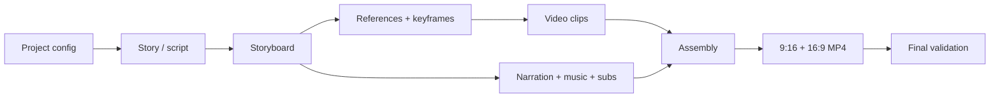

# Architecture

## Overview

The Heritage Short application is a **feature-based Python pipeline** orchestrated from `main.py`. All generation stages read and update **`storyboard.json`** as the single source of truth.

## Layers

| Layer | Role |
|-------|------|
| `core/` | Pipeline stages, cache fingerprints, dependency graph, logging, provider registry |
| `generators/` | Feature logic: story, image, video, audio, assembly |
| `providers/` | External model APIs + mock implementations |
| `validation/` | Storyboard schema, media checks, final deliverable checks |
| `schemas/` | JSON Schema contracts |

## Caching model

Each artifact path is keyed by a **fingerprint** hash of stage-specific inputs (see `core/dependency.py`). If inputs unchanged, the stage skips regeneration and logs `reused`.

## Error handling

Stages return structured results; failures record to `logs/runs.jsonl`. The pipeline supports **resume** via `--from-stage` on `generate`.

## Data flow per shot

Shots carry: IDs, duration, narration, prompts, reference IDs, artifact paths, and per-stage `generation_status` fields updated by generators.