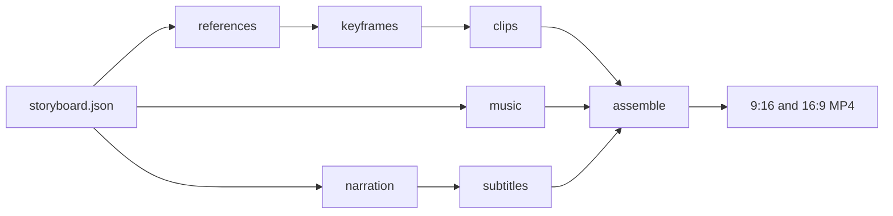

# Architecture

## Overview

Heritage Short is a **storyboard-driven pipeline**: every stage reads and updates `storyboard.json`. Entry points:

- `make film` / `run_film.py` — full run with optional `--real` and `--resume STAGE`
- `main.py STAGE` — single stage or `generate` with `--from-stage`

Model calls append to **`logs/runs.jsonl`** (one JSON object per line; `extra.type == "model_call"` for API calls).

## Assignment stages → this repository

| Brief stage | CLI stages | Code |
|-------------|------------|------|
| Script / storyboard | `validate`, `story` | `validation/storyboard.py`, `generators/story/` |
| Keyframes | `references`, `images` | `generators/image/`, `providers/flux.py` |
| Moving shots | `videos` | `generators/video/`, `providers/wan.py` (Ken Burns if no Wan URL) |
| Music | `music` | `generators/audio/music.py`, `providers/ace_step.py` |
| Narration | `narration` | `generators/audio/narration.py`, `providers/gemini_tts.py` |
| Assembly | `subtitles`, `assemble`, `final-check` | `generators/assembly/`, `validation/final_output.py` |

## Layers

| Layer | Role |
|-------|------|
| `core/` | Pipeline order, cache fingerprints, registry, logging |
| `generators/` | Per-stage business logic |
| `providers/` | Gemini TTS, Cloudflare FLUX, mocks, Ken Burns, ACE/Wan stubs |
| `validation/` | JSON Schema, media checks, final deliverable report |
| `schemas/` | `storyboard.schema.json` |

## Caching

`core/cache.py` + `core/dependency.py` hash **stage-specific inputs** (prompts, durations, reference IDs, etc.). If the fingerprint matches, the stage logs `reused` and skips the API/GPU call. Change one shot’s prompt or narration → only that shot’s keyframe/narration/clip should regenerate on the next run.

## Providers (this film)

| Artifact | Production run |
|----------|----------------|
| Images | Cloudflare `@cf/black-forest-labs/flux-1-schnell` |
| Narration | `gemini-3.8-flash-tts`, voice `Kore`, Amharic |
| Video | **Ken Burns** (FFmpeg zoom/pan on keyframes); `WAN_API_URL` provider not wired |
| Music | Mock heritage bed **or** `MUSIC_FILE` copy of an external WAV (e.g. ACE-Step from Kaggle) |

## Failure handling

- Stage errors → `logs/runs.jsonl` with `level: ERROR`
- `run_film.py` prints resume hint: `python3 run_film.py --resume STAGE`
- Gemini TTS uses HTTP retries on 408/429/5xx (`providers/gemini_tts.py`)

## Current deliverable

Film **“The Smile That Carried Him”**: 9 shots + 4 s end card, ~78 s total, paths under `outputs/`. See `storyboard.json` for shot reasons and prompts.